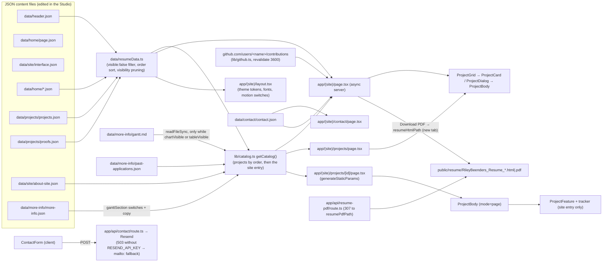

# Architecture and Data Flow

## Stack

- **Next.js `^16.4.5`**, App Router (`app/` directory), with Turbopack in dev.
- **React** `^19.2.7` + **TypeScript** `strict: true`.
- **framer-motion**: drives
  - `Reveal` entrances;
  - the nav's sliding active tint (`layoutId`);
  - the project cards' entrance and `layout`, the dialog's scale-in and `AnimatePresence`, the case-study height animation;
  - `CursorMark`'s spring;
  - `CountUp` / `ScrollWords`, the gallery wipes, and the site entry's timeline and demos.

  See [[Sheet Components (Home Page)]], [[Project Catalog and Dialog]] and [[Site Project (About this site)]].
- **lucide-react**: UI icons (`MapPin`, `Briefcase`, `Download`, `Mail`, `ArrowUpRight`, `Maximize2`, `X`, `ChevronDown`, `Send`, `GraduationCap`, `ExternalLink`, …). The GitHub and LinkedIn marks are `components/sheet/BrandIcons.tsx`, because lucide dropped its brand icons.
- **mermaid**: renders the job-tracker Gantt chart client-side when its switch is on ([[GanttChart JobsTable and gantt.ts]]).
- **jsPDF**: the former per-request resume generator, kept in `ResumeBuilder/` but imported by no route ([[Resume PDF Pipeline]]).
- **@vercel/analytics** + **@vercel/speed-insights**: mounted in the root `app/layout.tsx`. Analytics goes through the `SiteAnalytics` client wrapper, which adds the owner opt-out and a per-visit state/city event ([[Site Analytics]]).
- **next/font/google**: eight faces preloaded as CSS variables in `app/(site)/layout.tsx` (Instrument Serif, Spectral, Playfair Display, Fraunces, Source Serif 4, Inter, Space Grotesk, IBM Plex Mono). `header.json.fonts` picks which one fills `--bp-font-header` / `--bp-font-subheader` / `--bp-font-body` (today Instrument Serif / Instrument Serif / Inter). IBM Plex Mono is also the sheet's fixed label face (`--mono`). **next/og** + a bundled TTF render the OG image and apple icon.
- **Resend** (REST, no SDK): the message form's delivery, from `app/api/contact/route.ts`, only when `RESEND_API_KEY` is set.
- **playwright-core** (dev only): drives the machine's own Chrome/Edge for `scripts/capture-site-screenshots.mjs` and `scripts/check-anchor-hydration.mjs`. It is never part of the site bundle.

## Two-layer layout

- **`app/layout.tsx`** (root): the shell only. `<html>`/`<body>`, the `app/base.css` reset, `SiteAnalytics` + SpeedInsights, and static `metadata`. No chrome, no fonts.
- **`app/(site)/layout.tsx`**: the visible site.
  - Loads the eight Google faces as CSS variables.
  - Imports `app/(site)/sheet.css` and then the kept component sheets (`bullet-link.css`, `skill-pills.css`, `projects/projects.css`, `projects/feature.css`, `projects/walkthrough.css`).
  - Resolves the Studio's palette (`lib/theme.ts` → `resolveThemeTokens(resumeData.theme)`) and font roles into a `<style>` override on `.bp[data-theme-id]` (light) and `html[data-theme="dark"] .bp[data-theme-id]` (dark).
  - Wraps everything in `ThemeProvider` and `
`, which renders `<SiteNav>`, then `
{children}
`, then the portal host `
` (the project dialog renders into it, so the tokens scoped to `.bp` reach it).
  - Mounts `AnimationSync` when `motion.syncAnimations` is on, `SmoothScroll` when `motion.smoothScroll` is on, and `<StudioLink>` in development only.

  Every page route lives in this `(site)` group.

## Data flow, end to end

## The central merge: `data/resumeData.ts`

Every page imports one module, `@/data/resumeData`, which:

1. Imports `header.json`, the four `data/home/*.json` resume files, and the two `data/projects/*.json` files.
2. Drops every project and proof whose `visible` is `false` (the Studio's per-entry "draft" switch) and sorts the surviving projects by `order`.
3. Reads `header.json.visibility` (a `ResumeVisibility` object with 5 booleans) and uses it to **conditionally strip** `proofId`/`projectId` off experience bullets (`emphasis` phrases always pass through), and to zero out the `proofs`/`projects` arrays if nothing needs them.
4. Assembles and exports a single typed `ResumeData` constant: `person`, `visibility`, `theme`, `fonts`, `layout`, `motion`, `resumePdfPath` and `resumeHtmlPath` straight off the header, the rest merged.

Current flag values (`header.json`): `experienceProjectButtons: true`, `experienceProofButtons: false`, `projectsSection: true`, `proofIndex: false`, `openToRelocation: true`. The net effect:

- Experience bullets keep their `projectId` and lose their `proofId`. `Experience` turns a kept `projectId` into a Read more `BulletLink` (`/projects#project-<id>`, which opens that project's dialog on `/projects`), but only when the id belongs to a *published* project.
- `includeProofData` is `true` (`projectsSection` counts), yet every one of the 17 entries in `proofs.json` is `visible: false`, so `resumeData.proofs` is `[]` at runtime. Case studies come from each project's own `additionalInfo`.
- `resumeData.projects` is the published list: six projects. `lib/catalog.ts` adds the site entry after them.
- `openToRelocation` shows the hero chip, the fact-card suffix, and the contact block's relocation line.

These are **build-time content toggles**, flipped in the Studio's Site Settings, not runtime UI toggles. See [[Data Layer and Types]] for the exact logic.

## The catalog: `lib/catalog.ts`

`getCatalog()` turns the merged data into the cards the projects page and the home grid show.

- It is `buildProjectViews(resumeData.projects, resumeData.proofs)` plus a `cover` (the first photo, a PDF's first-page preview, a video's poster, or `null` for a typographic cover) and a `tagline`.
- It appends the **site entry** (`SITE_PROJECT_ID = "rileybeenders-com"`), reshaped from `data/site/about-site.json`, with its `feature` deep dive and the **tracker**. The tracker is `gantt.md` parsed by `parseGanttFile()` and merged with `past-applications.json` by `buildApplicationRows()`, under `more-info.json`'s `ganttSection` switches.
- The result is module-cached. With `projectsSection` off, the catalog is the site entry alone.
- `getEntry(id)` feeds `/projects/[id]`.

See [[Project Catalog and Dialog]].

## Server vs. client components

- **Server components.** `app/layout.tsx`, `app/(site)/layout.tsx` and the four page files have no `"use client"`.
  - `page.tsx` (home) is **async**: it awaits `getContributions()` (`lib/github.ts`), whose `fetch` is cached with `next: { revalidate: 3600 }`, so `/` is ISR with an hourly refresh.
  - `projects/[id]/page.tsx` is statically generated for every catalog id (`dynamicParams = false`).
  - `lib/catalog.ts` reads `gantt.md` with Node's `fs` at build time (only while a tracker switch is on).
  - `SiteFooter` calls `lib/build-stamp.ts` (git / `VERCEL_GIT_COMMIT_SHA`) for the revision line.
- **Client components** (`"use client"`):
  - In `components/sheet/`: `SiteNav`, `HeroActions`, `CursorMark`, `GithubGraph`, `Experience`, `ProjectGrid`, `ProjectCard`, `ProjectDialog`, `ProjectBody`, `ContactForm`, `SmoothScroll`.
  - In `components/blueprint/`, everything except `BpMark` and `BulletLink`.
  - Also `GanttChart` and the `components/projects/` tree (gallery, lightbox, PDF pages, compare, date box, status, `ProjectFeature` and its `feature/*` blocks and demos, the walkthrough).
- **Server-renderable** (no directive): `HeroCover`, `Stack`, `Education`, `ContactBlock`, `SiteFooter`, `BrandIcons`, `BpMark`, `BulletLink`, `JobsTable`, `EmphasizedText`, `Paragraphs`, `CaseStudy`, `ThemedShot`, `PostCard`.
- `mermaid` is loaded with a dynamic `import("mermaid")` inside `GanttChart`'s `useEffect`, so it never ships in the initial bundle. `pdfjs-dist` loads the same way, only when a PDF is opened.
- `HeroActions` dynamically imports `ResumeBuilder/downloadPublishedResume` only when the Download button is a button (no `resumeHtmlPath`) and is clicked.

## The two independent PDF paths

Two unrelated resume systems; don't conflate them:

1. **The main resume.** A static HTML + PDF pair in `public/resume/` (copied from `.DefaultResume/`), built from `ResumeBuilder/main-resume/main-resume.html` by the `update-main-resume` skill. The Download PDF button opens the HTML (`header.json` `resumeHtmlPath`) in a new tab, and its Print / PDF button saves the file. `/api/resume-pdf` redirects to the PDF (`resumePdfPath`). It changes only when that skill runs.
2. **Hand-tuned, per application.** The PDFs (and, since 2026-11-07, matching HTML resumes) in `1.ApplicationsUsed/` and `output/pdf/`. They are produced by invoking `create-custom-resume-pdf` / `create-custom-resume-html` against a specific posting in `2.JobsApplliedTo/`, using the same HTML layout and print scripts as the main resume, tailored per job.

Full detail in [[Resume PDF Pipeline]] and [[Job Application Tracker]].

## Related
- [[Project Overview]]
- [[Data Layer and Types]]
- [[Repository Map]]
- [[Routes Overview]]
- [[Home]]
